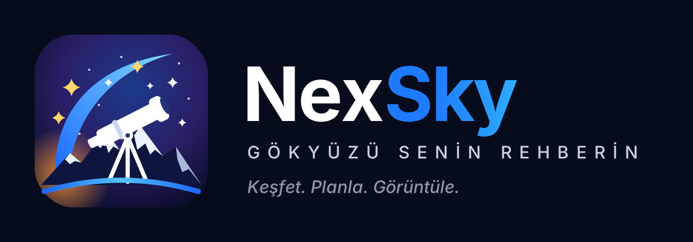

<p align="center"></p>

# NexSky — Gökyüzü senin rehberin

Ay ve gökyüzü fotoğrafçıları için ücretsiz, açık kaynak, **internetsiz çalışan** gökyüzü rehberi ve çekim planlayıcı. Nex ailesinden.

> Durum: **önizleme (0.3.x)**. Android + iPhone (web uygulaması).

| Bölüm | Ne yapar |
|---|---|
| **Arama** | "Mars", "Jüpiter", "Orion Bulutsusu", "M42", "Ülker", "Kutup Yıldızı", "Büyük Ayı"… yaz; şu an nerede (yön, yükseklik), bugün doğuş, en yüksek nokta ve batış saati, parlaklık, görünen büyüklük, uzaklık. |
| **Gökyüzü** | **Kamera** modunda canlı kamera görüntüsünün üstünde, **AR** modunda karanlık gökyüzü haritasında yıldızlar, takımyıldızlar, gezegenler, Ay ve derin uzay cisimleri gerçek konumlarında. "Görüş alanında" satırı o an kadrajdaki cisimleri listeler. Aranan cisim ekran dışındaysa ok seni ona çevirir. |
| **Planlayıcı** | **Ay:** doğuş/batış saati ve yönü, evre, aydınlanma, görünen büyüklük (süper ay), mesafe, yaklaşan evreler. **Güneş:** doğuş/batış, altın ve mavi saat. **Kadraj:** popüler makineler (P1000, P950, SX70, Canon/Nikon/Sony/Fuji gövdeleri, astro kameralar), telefonunun kendi kameraları; popüler objektif ve teleskoplar, telekonvertör — cismin kadrajda gerçek boyutu. |
| **Harita** | Ay ve Güneş doğuş/batış yönleri haritada. Ön plana (kale, minare…) uzun bas: doğan Ay'ı onun arkasında görmek için nerede durman gerektiğini hesaplar. |

## iPhone (web uygulaması)

iPhone/iPad için NexSky, App Store gerektirmeyen bir web uygulamasıdır: **https://eirahoutmoss.github.io/nexsky/**

1. Safari'de adresi aç → **Paylaş** → **Ana Ekrana Ekle**.
2. Ana ekrandaki NexSky simgesinden aç; konum iznini ver.
3. Gökyüzü sekmesinde **Kamera** veya **AR Modu**na dokun; iOS hareket (ve kamera) iznini sorar, "İzin Ver" de. Ekrandaki gökyüzü pusulayla kaymışsa parlak bir cismi ortalayıp **Hizala**'ya bas.

İlk açılıştan sonra internetsiz çalışır (harita altlığı hariç). Kaynak `docs/` klasöründedir; GitHub Pages bu klasörden yayımlar (Settings → Pages → `main` / `/docs`). Yeni sürüm yayımlandığında uygulama kendiliğinden güncellenir.

## Güncelleme

Hakkında ekranındaki **Güncellemeleri denetle** düğmesi GitHub'daki son sürümü kontrol eder; yeni sürüm varsa indirip (SHA-256 ve imza anahtarı denetlenerek) kurulumu başlatır. Sürüm yayımlarken APK'yı release'e ek olarak yükleyin (`vX.Y.Z` etiketi).

## Doğruluk

Konumlar [Astronomy Engine](https://github.com/cosinekitty/astronomy) (MIT, Don Cross) ile hesaplanır; JPL DE421 efemerisine göre Ay ve gezegenlerde yaklaşık 0,1–0,4 yay dakikası hata. Her şey telefonda hesaplanır, internet gerekmez (harita altlığı hariç; bakılan bölgeler önbellekte kalır).

## Derleme (Windows)

```powershell
powershell -ExecutionPolicy Bypass -File build-apk.ps1
```

Çıktı: `dist\NexSky.apk`. İlk derlemede imza anahtarı `%USERPROFILE%\.nexsky\` altında oluşturulur — **yedekleyin**.

Katalog verisi `tools/build_catalog.py` ile [d3-celestial](https://github.com/ofrohn/d3-celestial) verisinden üretilir.

## Lisans

MIT — © 2026 Hasan Güler. Üçüncü taraf: Astronomy Engine (MIT), Ay görüntüsü NASA SVS / LRO CGI Moon Kit (kamu malı), d3-celestial verisi (BSD-3), Inter yazı tipi (SIL OFL 1.1), harita © OpenStreetMap katkıda bulunanlar. Lisans metinleri `licenses/` klasöründe.
